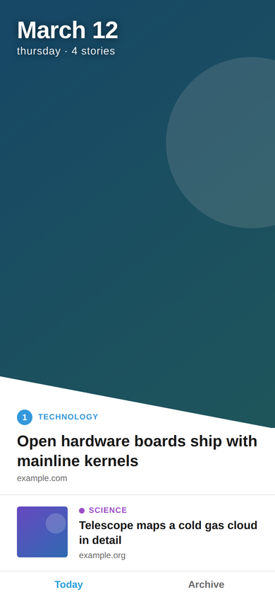
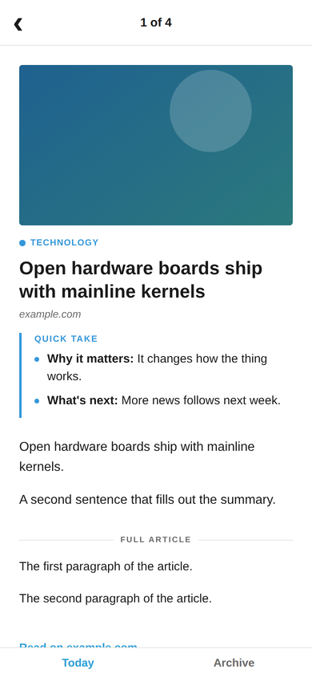
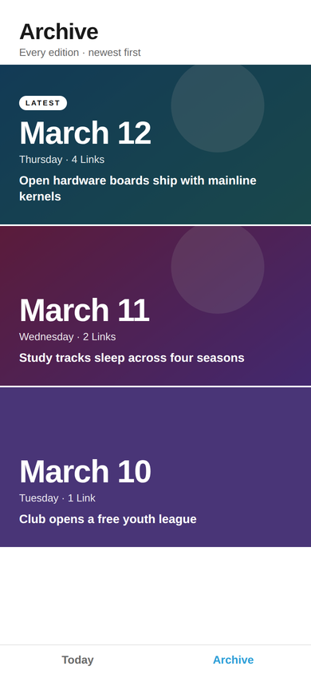
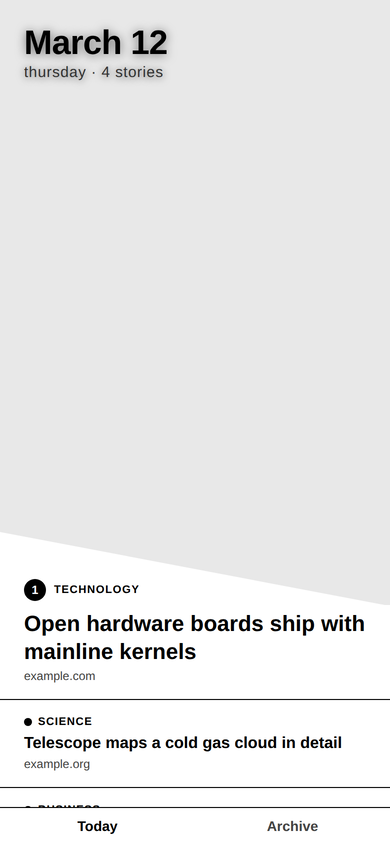

# Daily Dispatch

Daily Dispatch turns the links you send from your phone during the day into
a daily news digest and a two-host podcast episode, and puts both in a small
reading app styled after the old Yahoo News Digest. A Python pipeline
captures the links and writes the digest, the `daily-dispatch` CLI writes
and voices the podcast with the model and voice service you choose, an AWS
backend syncs it all and sends push notifications, and the app runs on
Android (phone and e-ink), iOS, the web, macOS, Linux and Windows.

Documentation: https://blbaker.github.io/daily-dispatch/ (goes live when the
repository is public).

<p>
  
  
  
  
  
</p>

Left to right: Today, an article, and the archive on a phone, the e-ink
build, and the desktop app on Windows. All of them show sample data.

## Platforms

- Android phone and Android e-ink tablets (a grayscale build of the same app)
- iOS, as an unsigned simulator build; device builds need an Apple
  developer account
- Web, as a static export with Web Push
- macOS on Apple silicon, Linux x64 and Windows x64, through
  [react-native-impeller-platform](https://www.npmjs.com/package/react-native-impeller-platform)

## Quick start

You need Git, Node.js 24, pnpm 10 or newer and Python 3.12 or newer. None of
these commands need an account or an API key.

```sh
git clone https://github.com/blbaker/daily-dispatch.git
cd daily-dispatch

# The desktop app against built-in sample editions
cd app
npm run desktop:install
npm run desktop:demo
cd ..

# A podcast script from the example stories, with no paid call
pnpm install
pnpm --filter daily-dispatch build
node packages/daily-dispatch/dist/cli/bin.js podcast make \
  --stories packages/daily-dispatch/examples/stories.example.json \
  --writer anthropic --voice elevenlabs \
  --voices packages/daily-dispatch/examples/voices.elevenlabs.example.json \
  --out /tmp/episode

# The pipeline's tests
python3 -m unittest discover -s tests
```

To run the app in a browser or on a phone, see
[docs/setup.md](docs/setup.md). To capture your own links and write a
digest, see [docs/pipeline.md](docs/pipeline.md).

## The podcast

The `daily-dispatch` CLI in `packages/daily-dispatch/` makes an episode in
two steps, and each step is an adapter you pick by name. A script writer
turns the day's stories into a two-host script. A voice provider reads it,
and ffmpeg joins the audio into one MP3 with a Markdown transcript. Adding a
writer or a voice service is one file plus one line in a registry.

Script writers:

- `anthropic`: the Anthropic Messages API, needs `ANTHROPIC_API_KEY`
- `openai`: the OpenAI Chat Completions API, needs `OPENAI_API_KEY`
- `ollama`: a local Ollama model, free
- `command`: any CLI that reads a prompt, `claude -p` by default

Voice providers:

- `elevenlabs`: ElevenLabs Text-to-Dialogue, needs `ELEVENLABS_API_KEY`
- `openai`: OpenAI text to speech, needs `OPENAI_API_KEY`
- `google`: Gemini multi-speaker TTS, needs `GEMINI_API_KEY`
- `polly`: Amazon Polly, needs AWS credentials and a region
- `azure`: Azure AI Speech, needs `AZURE_SPEECH_KEY` and a region
- `local`: any OpenAI-compatible TTS server such as Kokoro, free

Paid providers never run without `--confirm`. Without it the CLI prints the
character count and an estimated cost and sends nothing.
[docs/podcast-providers.md](docs/podcast-providers.md) has every option and
the voice map format, and [docs/daily-podcast.md](docs/daily-podcast.md#costs)
has the prices.

The older Python path, `pipeline/podcast_make.py` with the
`link-talk-podcast` skill, still works and uses ElevenLabs only.

## Daily episode (optional)

The CLI can make an episode at the same time every day. It is off until you
turn it on.

```sh
daily-dispatch podcast run --dry-run        # what today's run would cost
daily-dispatch schedule install --print     # shows the job, changes nothing
daily-dispatch schedule install             # systemd, cron, launchd or Task Scheduler
```

The job runs `daily-dispatch podcast run --if-due` every 15 minutes. Each
run reads the on/off switch, time and time zone from the backend's
`/settings`, or from `~/.config/daily-dispatch/config.json` without a
backend, so changing the time never means reinstalling the job. A GitHub
Actions template covers people with no always-on machine. See
[docs/daily-podcast.md](docs/daily-podcast.md).

## Push notifications

The backend sends a notification when a new edition is published and when a
new episode is ready.

- Android and iOS get them through the Expo push service, which needs an
  Expo access token, a Firebase FCM v1 key and an APNs key.
- The web app gets them through Web Push, which needs a VAPID key pair.
- The desktop app polls `GET /notifications/since` every 5 minutes and needs
  no credentials.

The backend reads the credentials from SSM, and a provider whose credentials
are missing stays off without breaking anything else.
[docs/push-setup.md](docs/push-setup.md) walks through creating each one, and
[docs/push-clients.md](docs/push-clients.md) covers the app side.

## Desktop

The desktop app is the same React Native code as the phone app, rendered by
the Impeller engine. There is no Electron and no web view.

```sh
cd app
npm run desktop:install
npm run desktop                    # against your backend, from app/.env
cd desktop && npm run package      # a package for this OS in app/desktop/dist/
```

[docs/desktop.md](docs/desktop.md) lists the system requirements and how
the packages are put together.

## Self-hosting the backend

The backend in `backend/` is one AWS CDK stack: a DynamoDB table billed per
request, a Lambda function behind a Function URL, two private S3 buckets for
app releases and episode audio, and an hourly push receipt check. It is
built for a single reader with one API key.

```sh
cd backend
pnpm install --frozen-lockfile --ignore-workspace
pnpm exec cdk synth --quiet                              # no AWS account needed
pnpm exec cdk deploy -c apiKey="$(cat path/to/api-key)"  # your account, by hand
```

[docs/backend.md](docs/backend.md) covers the deploy, the outputs, the
variables each client reads, and the API.

## Status

This is a working personal tool on its way to being a public project. Some
parts have only been checked with mocks or on some platforms:

- No paid API has been called by the new CLI. The Anthropic, OpenAI,
  ElevenLabs, Gemini, Polly and Azure adapters are tested against faked
  responses built from each service's documentation. A full episode has been
  made end to end with a local Ollama model and a local TTS server.
- The npm package is not published yet. The GitHub Actions podcast template
  refers to a version that is not on npm.
- The systemd timer was checked with `systemd-analyze`. The launchd plist and
  the Task Scheduler task have not been loaded by a real scheduler.
- Push delivery through FCM, APNs or a browser push service has not been
  tried, because it needs real credentials. The push routes in the backend
  have not been deployed.
- Desktop notifications fall back to an in-app strip until the engine's
  notifications module is released. The macOS app has passed its headless
  render check but has not been opened in a window.
- The iOS app has only been built for the simulator, and the Android build
  with push support has not been installed on a device.
- The CI workflows and this documentation site have not run on GitHub yet.

## Contributing

[CONTRIBUTING.md](CONTRIBUTING.md) covers setting up a clone, the checks for
each part, commit messages (Release Please reads them), and the pull request
flow. Coding agents should read [AGENTS.md](AGENTS.md). Please also read the
[code of conduct](CODE_OF_CONDUCT.md), and report security problems as
[SECURITY.md](SECURITY.md) describes.

## License

MIT. See [LICENSE](LICENSE).
